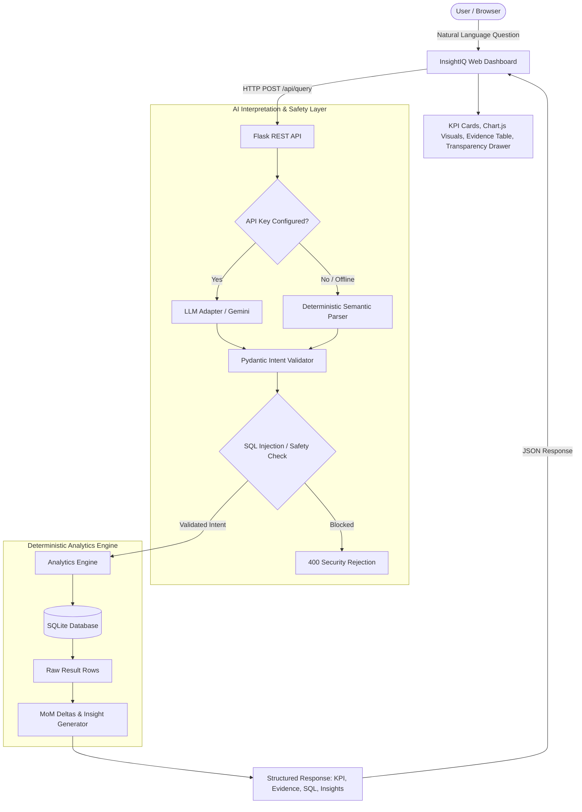

# InsightIQ — Production-Minded AI Business Intelligence Assistant

> **Submission for the RSG Graduate Engineer Trainee Selection Challenge**
> *A deterministic, trustworthy AI analytics assistant combining natural-language intent understanding with parameterized SQL execution and transparent auditability.*

---

## 1. System Overview & Architecture

InsightIQ bridges natural language queries with enterprise-grade sales business intelligence. Rather than permitting an LLM to hallucinate calculations or execute unconstrained SQL, InsightIQ enforces a **hybrid decoupled architecture**:
1. **AI Layer (Interpretation):** Translates free-form user questions into validated, allowlisted analytical intents.
2. **Deterministic Layer (Calculation):** Parameterized, read-only SQL queries executed directly in SQLite, guaranteeing 100% calculation accuracy and reproducibility.



---

## 2. Core Features & Compliance Matrix

| Deliverable / Feature | Status | Verification Method |
| :--- | :---: | :--- |
| **CSV Ingestion into Database** | ✅ Completed | SQLite `sales_transactions` with indexed dates, products, regions |
| **Data Cleaning & Exclusions** | ✅ Completed | Excluded missing price (`TXN0051`), excluded returns (`TXN0033`), flagged zero qty (`TXN0034`), rejected duplicates |
| **Total Revenue Calculation** | ✅ Completed | Returns 1,439,200.00 across 49 valid completed transactions |
| **Highest-Revenue Product** | ✅ Completed | Identifies Monitor (473,000.00; 32.9% share) with full ranked breakdown |
| **Monthly Revenue Trend** | ✅ Completed | 6-month chronological breakdown, peak month (May: 318,500.00), MoM deltas |
| **Highest-Sales Region** | ✅ Completed | Identifies South (411,200.00, 182 units) and compares all 4 regions |
| **Two-Month Comparison** | ✅ Completed | Compares Feb 2026 vs May 2026 (+83,900.00; +35.76%), handles zero baselines safely |
| **Executive Sales Summary** | ✅ Completed | Deterministically synthesizes total revenue, leading product, leading region, peak month, and MoM deltas |
| **Context-Aware Follow-ups** | ✅ Completed | Dynamically generates clickable follow-up queries based on current results |
| **Polite Rejection of Unrelated Inquiries** | ✅ Completed | Explains sales focus and presents supported examples without false classification |
| **AI Intent Interpretation** | ✅ Completed | Dual-mode: Configurable Gemini/OpenAI adapter + Rule-based fallback |
| **SQL Safety & Allowlisting** | ✅ Completed | Zero dynamic SQL concatenation; blocks destructive commands; read-only |
| **Interactive User Interface** | ✅ Completed | Polished dashboard with search, prompt chips, Chart.js charts, follow-ups, history |
| **Automated Testing Suite** | ✅ Completed | 38 automated tests passing in pytest (exceeds the 5-12 requirement) |
| **Data Quality Transparency** | ✅ Completed | Modal audit log showing exact row-level exclusions and 96.08% score |

---

## 3. Revenue Definition & Business Semantics

The sales dataset is the authoritative source of truth. InsightIQ enforces a strict, documented revenue policy:

$$\text{Transaction Net Revenue} = (\text{Quantity} \times \text{Unit\_Price}) - \text{Discount\_Amount}$$

> **Currency Policy Note:** The dataset does not declare an explicit currency symbol (e.g. USD, EUR, INR). To adhere to strict data fidelity standards, InsightIQ displays formatted numeric values neutrally (e.g., `1,439,200.00`) without fabricated currency symbols.

### Ingestion & Cleaning Rules:
1. **Missing Prices (`TXN0051`):** In `TXN0051`, `Unit_price` is missing. To prevent fabricating artificial numbers, this transaction is excluded from revenue and logged with an `EXCLUSION` severity in the audit log.
2. **Returned Orders (`TXN0033`):** Status is `'Returned'`. To measure true completed top-line sales, returned orders are excluded from completed revenue and audited separately.
3. **Zero Quantity (`TXN0034`):** Quantity is `0`. This order contributes 0.00 and 0 units to totals while remaining in the database as an audited completed transaction.
4. **Discount Amounts:** Lump-sum order deductions (`Discount_amount`) applied to transaction totals (e.g. `TXN0004` has a 500.00 lump-sum discount on 6 monitors: $6 \times 9500 - 500 = 56,500.00$).
5. **Duplicate Transaction IDs:** Any duplicate `Transaction_Id` is caught during ingestion, logged in `data_quality_log`, and skipped to prevent duplicate counting.
6. **Date Normalization:** Dates formatted as `DD-MM-YYYY` in the CSV are ingested into SQLite as ISO `YYYY-MM-DD` strings, allowing standard indexable SQL date functions (`strftime('%Y-%m', order_date)`).

---

## 4. Quick Start & Execution

### Prerequisites
- Python 3.10+ (tested and verified on Python 3.12)
- pip

### 1. Installation
Clone the repository and install dependencies:
```bash
git clone <repo-url>
cd InsightIQ
pip install -r requirements.txt
```

### 2. Run the Application
Start the application using the automated launcher script:
```bash
./run.sh
```
*Alternatively, start directly using the virtual environment or Python 3.12:*
```bash
./venv/bin/python app.py
# or
python3.12 app.py
```
Open your browser and navigate to:
```
http://127.0.0.1:5001
```

*(Optional)* To configure an LLM provider:
```bash
export GEMINI_API_KEY="your-gemini-api-key"
# or
export OPENAI_API_KEY="your-openai-api-key"
./run.sh
```
*Note: If no API key is set, InsightIQ automatically operates in deterministic fallback mode with zero degradation in analytical capability.*

### 3. Run Automated Tests
Execute the full test suite using the automated test runner:
```bash
./test.sh
```
*Alternatively:*
```bash
./venv/bin/pytest -v tests/
```
All 38 tests will execute in under 1 second.

---

## 5. REST API Documentation

### `POST /api/query`
Processes natural language inquiries and returns structured analytics results.

**Request:**
```json
{
  "question": "Compare revenue between February 2026 and May 2026"
}
```

**Response (200 OK):**
```json
{
  "success": true,
  "operation": "compare_months_revenue",
  "title": "Revenue Comparison: 2026-02 vs 2026-05",
  "primary_metric": "+35.76%",
  "primary_metric_label": "Growth (2026-02 to 2026-05)",
  "primary_metric_secondary": "Diff: +83,900.00",
  "summary": "Revenue between 2026-02 (234,600.00) and 2026-05 (318,500.00) showed an increase of 83,900.00 (+35.76%).",
  "executed_sql": "SELECT strftime('%Y-%m', order_date) AS month, COALESCE(SUM(calculated_revenue), 0.0) AS total_revenue, COUNT(*) AS transaction_count, COALESCE(SUM(quantity), 0) AS total_units FROM sales_transactions WHERE is_valid_completed = 1 AND strftime('%Y-%m', order_date) IN (?, ?) GROUP BY strftime('%Y-%m', order_date);",
  "sql_parameters": ["2026-02", "2026-05"],
  "evidence": [
    {"Period": "2026-02", "Revenue": "234,600.00", "Orders": "8", "Units": "129"},
    {"Period": "2026-05", "Revenue": "318,500.00", "Orders": "8", "Units": "126"},
    {"Period": "Absolute Variance", "Revenue": "+83,900.00", "Orders": "0", "Units": "-3"},
    {"Period": "Percentage Change", "Revenue": "+35.76%", "Orders": "N/A", "Units": "N/A"}
  ],
  "insights": [
    "2026-05 recorded 318,500.00 vs 2026-02 with 234,600.00.",
    "Net shift: +83,900.00 (growth of +35.76%)."
  ],
  "latency_ms": 0.25,
  "interpretation": {
    "intent": "compare_months_revenue",
    "mode": "fallback_rules",
    "confidence": 0.95
  }
}
```

### `GET /api/data-quality`
Returns full database audit metrics, status breakdown, and row-level issues.

### `GET /api/history`
Returns recent in-session query logs with timestamps and primary metrics.

### `GET /api/health`
Health check endpoint reporting database integrity and active interpreter mode.

---

## 6. Security & Guardrails

- **Zero Arbitrary SQL:** The system never executes SQL generated by a model. All operations map to hardcoded, allowlisted SQL templates.
- **Strict Parameterization:** Month, region, and product values are passed strictly via SQLite `?` bind parameters.
- **SQL Injection Interceptor:** Inbound strings are evaluated against regex patterns catching `DROP`, `DELETE`, `UNION`, `--`, `;`, and multi-statement injection.
- **Safe Baseline Math:** Two-month comparisons check for zero or negative revenue in baselines, avoiding Python `ZeroDivisionError` and presenting clear explanations.

---

## 7. Known Limitations & Next Steps

1. **Current Schema Scope:** The SQLite database currently indexes a single table `sales_transactions`. Multi-table relational joins (e.g., customers, inventory margins) would be natural extensions.
2. **Dynamic Aggregations:** While the system answers all required questions and variations, arbitrary ad-hoc groupings (e.g., "sales on alternate Tuesdays in rain") require adding an allowlisted intent.
3. **Session Query History:** Session history is currently stored in-memory; persisting it across browser reloads via SQLite or Redis would enhance audit trails in multi-user settings.
